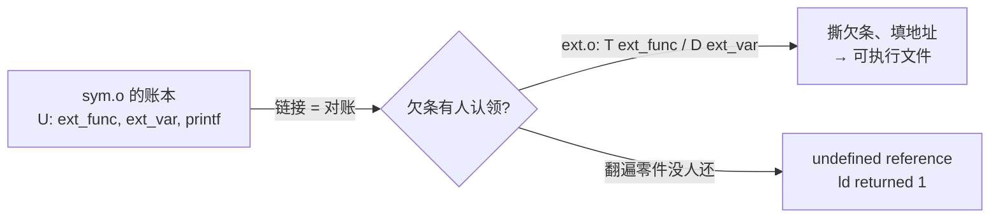

# 用 nm 看懂 undefined reference

## 这一篇想解决什么

咱们写 C/C++ 最吓人的一激灵，不是编译报错，是编译**过了**、链接突然翻脸的那句：

```text
undefined reference to `xxx'
```

明明 IDE 没飘红、`gcc -c` 也安安静静出了 `.o`，怎么到了最后一步说缺东西？缺的又到底是什么？这一篇咱们就把这个报错解剖到骨头：用 `nm` 把 `.o` 里的**符号表**翻出来当账本看，哪些是欠条、哪些是资产，链接器怎么拿着这本账一一配对，对不平时报的那句话到底在说什么、怎么顺着它把账平掉。

环境跟 M1 完全一样：host 上 `gcc 16.1.1`、`ld 2.47`、x86-64 的 Arch on WSL2。两个小 `.c` 文件，不要硬件。下面每条命令、每段输出都是笔者本机真跑的，文末附完整记录，照着能复现。

## 符号表：.o 的账本

把"符号"这个词落地。上一篇咱们看过，`.o` 是分段的：`.text` 装代码、`.data` 装有初值的全局、`.bss` 装没初值的全局。这一篇要问的是：**段里住着的每个东西，叫什么名字？** 答案就是符号（symbol）：一个函数、一个全局变量，编译之后就是一个符号。而记录"本文件有哪些符号、各自什么状态"的表格，就是**符号表**。

理解符号表，咱们只需要记住一组二分。**定义是资产**：在本文件里写出了函数体、写出了 `int g = 1;`，编译器就真的在段里造出了这个东西，这是本文件能**提供**给别人的。**声明是欠条**：一句 `extern int ext_var;` 或一句函数原型，只是告诉编译器"有这个东西、长这样"，这是咱们**要用**、但承认自己没有的。

只有全局函数和全局变量有资格记账。咱们在函数里写的局部变量住在寄存器或栈上，根本不进文件里的段，自然也不进符号表。

而链接器（`ld`，gcc 在背后调它）干的事就是**拿着账本配对**：把所有 `.o` 的欠条和资产两两撮合。每个欠条都能找到资产，账平，出可执行文件；有一张欠条没人认领，就报咱们最怕的那句话。所以记住一句总纲：**undefined reference 不是语法错误，是账务错误**——账本上有个 U 没人还。

## 用 nm 给 .o 拍一张 X 光

空讲不如实拍。咱们写一个"七种符号全齐"的玩具文件，故意把每种状态都占一样：

```c
/* sym.c */
#include <stdio.h>

int g_init = 1;        /* 有初值的全局变量   → 应进 .data */
int g_uninit;          /* 没初值的全局变量   → 应进 .bss  */
static int s_init = 2;    /* 有初值的 static  → 段同上，但不给外人看 */
static int s_uninit;      /* 没初值的 static  → 同上 */

extern int ext_var;    /* 只声明，定义在别的文件 → 留个"欠条" */
int ext_func(void);    /* 只声明，定义在别的文件 → 留个"欠条" */

static int helper(void) { return 7; }   /* 本文件私有的函数 */
int pub(void) { return helper(); }      /* 对外公开的函数 */

int main(void) {
    printf("%d\n", ext_var + ext_func() + pub()
                   + g_init + g_uninit + s_init + s_uninit);
    return 0;
}
```

咱们编译只到 `.o`（注意 `-c`，别让 gcc 一口气链完），然后请 `nm` 上场：

```bash
gcc -c sym.c
nm sym.o
```

```text
                 U ext_func
                 U ext_var
0000000000000000 D g_init
0000000000000000 B g_uninit
0000000000000000 t helper
0000000000000016 T main
                 U printf
000000000000000b T pub
0000000000000004 d s_init
0000000000000004 b s_uninit
```

咱们拿到一张账本，十个符号，正好把字母表凑齐了。左边一列是**值**（地址，等会儿说），中间的**字母是状态**，右边是名字。字母的规律一句话就能记住：**字母对应它住的段，大小写对应内外**。

| 字母 | 住的段  | 大写（对外）                       | 小写（static 私有）         |
| ---- | ------- | ---------------------------------- | --------------------------- |
| `U`  | 没着落  | 欠条：用了但本文件没定义，等别人还 | ——                          |
| `T`  | `.text` | `main`、`pub`：代码资产，人人可链  | `t`：`helper`，只许本文件用 |
| `D`  | `.data` | `g_init`：有初值全局资产           | `d`：`s_init`               |
| `B`  | `.bss`  | `g_uninit`：没初值全局资产         | `b`：`s_uninit`             |

咱们对照源码逐个验一遍：`g_init` 是 D、`g_uninit` 是 B，跟 M1 里 `.data`/`.bss` 的分法严丝合缝；`helper` 和 `pub` 都在 `.text`，但一个 `t` 一个 `T`——**`static` 不改变住哪个段，只是把符号从"对外"改成"私有"**，别的文件想链也链不到它。还有 `.rodata` 对应的 `R` 本例没出现（字符串字面量不产生符号），见着认得就行。

咱们再看值那一列：`main` 是 `0x16`、`pub` 是 `0xb`、`s_init` 是 `4`，都小得可怜。因为**在 `.o` 里，这个值只是段内偏移**，`pub` 就在 `.text` 开头数第 0xb 个字节处；真正的运行时地址还没定，这正是 M1 留下的伏笔：重定位是链接的主场。还有个细节：U 的值是空的，欠条嘛，自己没有地址，等还账的人填。

最后，`printf` 也在 U 名单里！咱们从没定义过它，只用了一张它的欠条，这说明**连标准库函数走的都是同一套账**：咱们手上这个 `.o` 欠着 `printf`，由 libc 来还。平时 `gcc` 自动帮咱们链了 libc，所以咱们没感觉。

还有个实用小开关：`nm -u` 只列欠条，咱们一眼就能看清本文件欠了谁：

```bash
nm -u sym.o
```

```text
                 U ext_func
                 U ext_var
                 U printf
```

## 复现那个报错，逐行读懂它

账本在咱们手上，现在故意让账对不平：只链 `sym.o` 自己，让那两张 `ext_*` 欠条没人还：

```bash
gcc sym.o -o sym
```

```text
/usr/bin/ld: sym.o: warning: relocation against `ext_var' in read-only section `.text'
/usr/bin/ld: sym.o: in function `main':
sym.c:(.text+0x20): undefined reference to `ext_func'
/usr/bin/ld: sym.c:(.text+0x26): undefined reference to `ext_var'
/usr/bin/ld: warning: creating DT_TEXTREL in a PIE
collect2: error: ld returned 1 exit status
```

咱们逐行拆。第 1、5 行是 warning，第 6 行是收尸，真正的裁决在第 2–4 行。开头自报家门的 `/usr/bin/ld` 说明：报错的是链接器，不是编译器，这事发生在链接阶段。`in function 'main'` 回答的是谁在要，是 `main` 函数。`sym.c:(.text+0x20)` 回答的是在哪里要：`main` 的代码段里，从 `.text` 偏移 0x20 的那条指令。最后 `undefined reference to 'ext_func'` 回答要什么没要到——`ext_func` 这张欠条翻遍所有零件，没人认领。

那两条 warning 是同一件事的副产品：`main` 里有一条直接读 `ext_var` 的指令落在只读的 `.text` 里，而这个引用没着落，PIE 模式的 ld 就多嘀咕两句，说它将被迫造出 `DT_TEXTREL`。重定位的细节是后面几篇的主场，咱们这里只需要学会一件事：**真实输出里有杂音，抓住 `undefined reference` 那几行主线就够了**。

咱们很多人第一反应都会问：`gcc -c sym.c` 明明一声不吭就过了，编译器为什么不当场抱怨 `ext_func` 没定义？因为 **C/C++ 允许编译时只声明、不实现**，声明是合法的欠条，编译器管不了别的文件里有没有人还账。到底是有意把定义放在别处，还是粗心漏写了，这个裁决权整个交给了链接器。所以"编译过、链接炸"不是玄学，是分工。

## 用 nm 破案：缺谁、找谁、补谁

现在把侦探流程走完。欠债清单刚才已经列过了：`ext_func`、`ext_var`（`printf` 不用咱们管，libc 会还）。接着写一个债主文件，把这两个定义补上：

```c
/* ext.c */
int ext_var = 10;

int ext_func(void) { return 3; }
```

咱们验货再还账，看看它账本上是不是真有这两笔资产：

```bash
gcc -c ext.c
nm ext.o
```

```text
0000000000000000 T ext_func
0000000000000000 D ext_var
```

`T ext_func`、`D ext_var`，两个资产都在。最后咱们把两个 `.o` 一起链上，跑一遍：

```bash
gcc sym.o ext.o -o sym
./sym; echo "exit=$?"
```

```text
23
exit=0
```

账平了：10（ext_var）+ 3（ext_func）+ 7（helper）+ 1 + 0 + 2 + 0 = 23。咱们把整个配对过程画成图：



以后咱们再见到 undefined reference，别急着乱改，按三步走：拿 `nm -u` 列出欠谁，想清楚谁应该有，再把那个 `.o` 或定义补上。这就是不靠玄学排这类错的全部方法论。

## 链完再照一次：U 没清零，但账平了

最后一个容易迷糊的点：链完的可执行文件里，U 清零了吗？咱们照一下就知道：

```bash
nm sym | grep -E 'ext_|printf| U '
```

```text
00000000000011af T ext_func
0000000000004020 D ext_var
                 U __libc_start_main@GLIBC_2.34
                 U printf@GLIBC_2.2.5
```

这份输出里，咱们看到 `ext_func`、`ext_var` 从 `.o` 里的段内偏移（0、0）变成了真地址 `0x11af`、`0x4020`，欠条撕掉、地址落座，这就是链接干的活。`printf` 呢，居然还是 U！但注意它尾巴上多了 `@GLIBC_2.2.5`：链接器发现它由动态库提供，就在可执行文件里记下"这笔欠账运行时找 libc 结清"，由加载器在程序启动前付清。所以**可执行文件里的 U 不一定是错**，带 `@` 版本号的 U 是"运行时再还"的合法欠条。这套动态库的账怎么算，M5 展开。

还有一批名字咱们不用慌：`nm sym` 吐出的 `_start`、`register_tm_clones` 这些没听过的东西，是 gcc 塞进来的启动和收尾机器，不是咱们写的，也不用管。

## 账对不上的另一种崩法：multiple definition

欠条没人还是一种崩，资产撞车是另一种：两个文件都定义了同一个符号。咱们快速踩一遍，再造一个也定义 `ext_var` 的文件，三个 `.o` 一起链：

```bash
gcc -c dup.c          /* int ext_var = 99; */
gcc sym.o ext.o dup.o -o sym_dup
```

```text
/usr/bin/ld: dup.o:(.data+0x0): multiple definition of `ext_var'; ext.o:(.data+0x0): first defined here
collect2: error: ld returned 1 exit status
```

同样编译全过、链接才翻脸：账本要求一个名字只有一份资产，咱们给两份，ld 直接拒收。这个方向怎么修（`static` 私有化为什么能消冲突、什么时候又会变成静默覆盖）是短篇 [S4](/season1/shorts/s4-multiple-definition) 的主场，这里只要记住对称的两句：**欠多了是 undefined reference，多了是 multiple definition，裁决都在链接器**。

## 小结

符号表是 `.o` 的账本：定义是资产（大写 `T/D/B` 对外、小写 `t/d/b` 是 `static` 私有），声明是欠条（`U`）；`nm` 翻账本，`nm -u` 只看欠债。链接就是拿所有 `.o` 的欠条和资产一一配对，残留 U 报 `undefined reference`。它是账务错误，不是语法错误，修法三步：列债、找债主、补上。链完的文件里资产落了真地址，带 `@GLIBC` 的 U 是动态库的合法欠条。至于欠条和资产都齐了、零件太多怎么管，那是咱们的下一站。

自测几个点。看到 `nm` 输出，咱们能不能说出每个字母的含义、大小写差在哪？`undefined reference` 报错里 `in function 'main'` 和 `(.text+0x20)` 各自指什么？为什么 `gcc -c` 不抱怨缺定义？可执行文件里的 `U printf@GLIBC_2.2.5` 又为什么不是错？

## 接下来

两个 `.o` 散着放还好，真项目里几十上百个呢？而且很多第三方代码（HAL、CMSIS、libgcc）根本不给咱们源码，只给一包**预先编好的 `.o` 集合**——库。下一篇咱们就亲手 `ar` 打一个静态库出来，看链接器怎么拿着欠债清单到库里**按 `.o` 粒度**挑零件、为什么库在命令行上的位置能让老手也翻车。


## 附录：完整输出记录

下面是笔者本机所有关键命令的完整实测输出（工具链：gcc 16.1.1 / GNU ld 2.47 / x86-64 Arch on WSL2，实测日期 2026-08-24）。

```text
######## 工具链版本 ########
gcc (GCC) 16.1.1 20260728
GNU ld (GNU Binutils) 2.47
Linux 6.18.33.2-microsoft-standard-WSL2 x86_64

######## nm sym.o（符号七态全齐）########
$ gcc -c sym.c
$ nm sym.o
                 U ext_func
                 U ext_var
0000000000000000 D g_init
0000000000000000 B g_uninit
0000000000000000 t helper
0000000000000016 T main
                 U printf
000000000000000b T pub
0000000000000004 d s_init
0000000000000004 b s_uninit

######## nm -u sym.o（欠债清单）########
$ nm -u sym.o
                 U ext_func
                 U ext_var
                 U printf

######## 单链 sym.o：复现 undefined reference ########
$ gcc sym.o -o sym
/usr/bin/ld: sym.o: warning: relocation against `ext_var' in read-only section `.text'
/usr/bin/ld: sym.o: in function `main':
sym.c:(.text+0x20): undefined reference to `ext_func'
/usr/bin/ld: sym.c:(.text+0x26): undefined reference to `ext_var'
/usr/bin/ld: warning: creating DT_TEXTREL in a PIE
collect2: error: ld returned 1 exit status

######## 债主 ext.o 的账本 ########
$ gcc -c ext.c
$ nm ext.o
0000000000000000 T ext_func
0000000000000000 D ext_var

######## 修复：两账合并 ########
$ gcc sym.o ext.o -o sym
$ ./sym; echo "exit=$?"
23
exit=0

######## 可执行文件里的符号（节选）########
$ nm sym | grep -E 'ext_|printf| U '
00000000000011af T ext_func
0000000000004020 D ext_var
                 U __libc_start_main@GLIBC_2.34
                 U printf@GLIBC_2.2.5

######## 撞车：multiple definition ########
$ gcc -c dup.c
$ gcc sym.o ext.o dup.o -o sym_dup
/usr/bin/ld: dup.o:(.data+0x0): multiple definition of `ext_var'; ext.o:(.data+0x0): first defined here
collect2: error: ld returned 1 exit status
```

